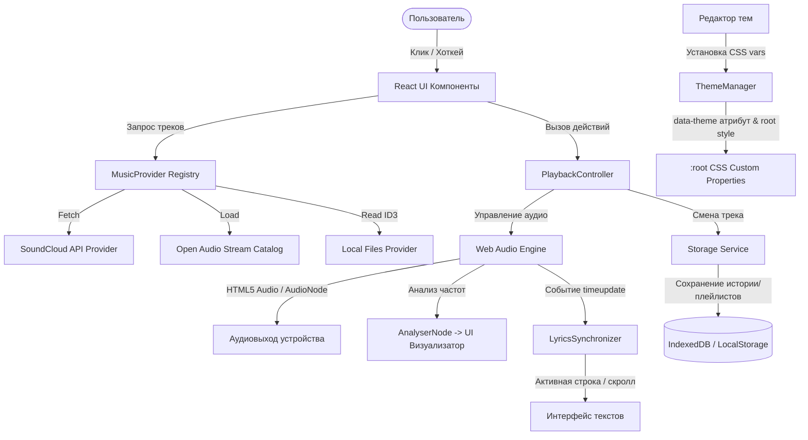

# SonicFlow — Архитектура проекта

Документ описывает структурную организацию приложения, разделение ответственности между слоями, поток данных и ключевые модули.

## 1. Общие принципы

Архитектура SonicFlow построена вокруг принципа **Clean Architecture / Modular Separation**:
- **Независимость UI от источников данных**: React-компоненты не содержат прямой сетевой или аппаратной логики. Они подписываются на сервисы через хуки и менеджеры.
- **Инверсия зависимостей**: Плеер оперирует абстрактным интерфейсом трека `AudioTrack`, независимо от того, получен ли он из SoundCloud, локального хранилища или встроенного стрима.
- **Единый источник правды (SSOT)**: Состояние воспроизведения (`PlaybackState`) управляется через синглтон `AudioEngine` и контекст `PlayerContext`.

## 2. Структура каталогов

```text
sonicflow/
├── src/
│   ├── assets/              # Векторная графика, логотипы, плейсхолдеры
│   ├── components/          # Презентационные и интерактивные UI-компоненты
│   │   ├── layout/          # Трехколоночная сетка: Sidebar, Center, Queue/Player
│   │   ├── navigation/      # Меню, история навигации, переключатели
│   │   ├── player/          # Мини-плеер, полноэкранный плеер, винил
│   │   ├── lyrics/          # Синхронизированный экран текстов песен
│   │   ├── search/          # Поисковая строка и выдача результатов
│   │   ├── library/         # Плейлисты, история, избранное, локальные треки
│   │   ├── theme-editor/    # Визуальный редактор тем и превью
│   │   ├── mobile/          # Адаптированные экраны для iOS (винил + шторка)
│   │   └── common/          # Кнопки, модальные окна, слайдеры, бейджи
│   ├── core/
│   │   ├── player/          # AudioEngine, PlaybackController, Web Audio API
│   │   ├── lyrics/          # LRC-парсер, LyricsSynchronizer, Netease/LRCLIB клиент
│   │   ├── music-providers/ # SoundCloud API, fallback-каталог, локальные файлы
│   │   ├── themes/          # ThemeManager, реестр тем, валидация контраста
│   │   └── storage/         # LocalStorage, IndexedDB, менеджер плейлистов
│   ├── hooks/               # React-хуки для доступа к сервисам
│   ├── types/               # TypeScript интерфейсы и типы данных
│   ├── App.tsx              # Корневой компонент приложения
│   ├── main.tsx             # Точка входа в DOM
│   └── index.css            # Базовые стили и подключение CSS-токенов
├── docs/                    # Исчерпывающая документация
├── tests/                   # Модульные и интеграционные тесты
└── tauri/                   # Конфигурация для сборки нативных десктоп-версий
```

## 3. Диаграмма потока данных



## 4. Ключевые сервисы

### `AudioEngine`
- Обёртка над нативным `HTMLAudioElement` и `AudioContext`.
- Предоставляет события `timeupdate`, `ended`, `error`, `play`, `pause`.
- Анализатор спектра `AnalyserNode` для анимированного эквалайзера в шапке.
- Безопасное переключение аудиопотоков без утечки обработчиков и перекрытия звука.

### `LyricsSynchronizer`
- Разбирает LRC-строки формата `[mm:ss.xx] Текст`.
- Вычисляет текущую активную строку бинарным поиском по отсортированному массиву таймкодов за `O(log N)`.
- Поддерживает режимы: синхронизированный текст, караоке (подсветка слов), статический текст без таймкодов.

### `MusicProvider`
- Абстрактный контракт `search(query)`, `getTrack(id)`, `getStreamUrl(track)`.
- Провайдер SoundCloud работает с публичным API и fallback-резолвером.
- Провайдер локальных файлов читает аудио через `URL.createObjectURL` и парсит метаданные.

### `ThemeManager`
- Управляет 9 встроенными темами и пользовательскими кастомизациями.
- Применяет токены через `document.documentElement.style.setProperty` и `data-theme`.
- Содержит модуль валидации WCAG 2.2 контраста (коэффициент не менее 4.5:1 для основного текста).
