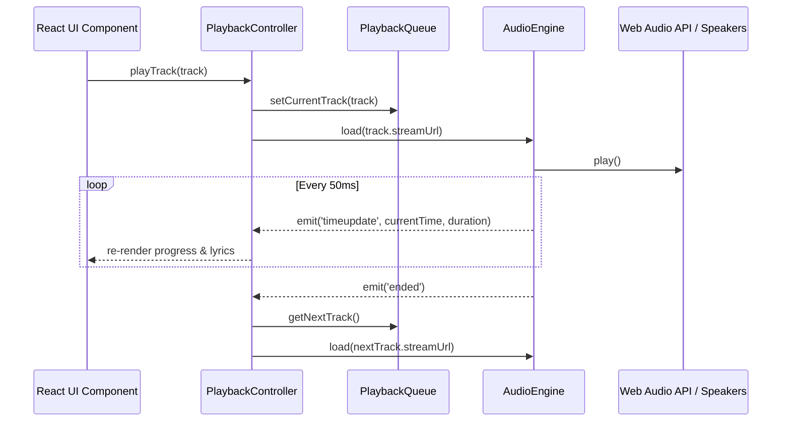

# SonicFlow — Архитектура аудиоплеера (Player Architecture)

Документ описывает реализацию аудиодвижка `AudioEngine`, интеграцию с Web Audio API, управление очередью воспроизведения и жизненный цикл аудиотреков.

---

## 1. Стек и технологии воспроизведения

SonicFlow использует гибридную связку:
- **HTML5 Audio Element (`HTMLAudioElement`)**: отвечает за потоковую буферизацию, работу с сетевыми стримами, плавное декодирование и обработку ошибок CORS/кодеков.
- **Web Audio API (`AudioContext`)**:
  - `MediaElementAudioSourceNode` связывает HTML5 аудио с аудиографом.
  - `AnalyserNode` вычисляет БПФ (Fast Fourier Transform, FFT) для 32/64 частотных полос в реальном времени, обеспечивая работу динамического эквалайзера в интерфейсе.
  - `GainNode` обеспечивает плавное затухание/нарастание громкости (crossfade) при смене треков или паузе.

---

## 2. Архитектура классов

```text
src/core/player/
├── AudioEngine.ts        # Синглтон работы с HTML5 Audio & AudioContext
├── PlaybackQueue.ts      # Управление списком воспроизведения, перемешиванием и историей
├── PlaybackController.ts # Фасад для React UI: вызовы play, pause, next, prev, seek
└── types.ts              # Интерфейсы AudioTrack, PlaybackState, PlaybackMode
```

### Диаграмма взаимодействия:



---

## 3. Режимы воспроизведения (Playback Modes)

- **Normal**: Последовательное воспроизведение очереди с остановкой по завершении последнего трека.
- **Repeat All (`repeat: 'all'`)**: По окончании последнего трека очередь начинается сначала с индекса 0.
- **Repeat One (`repeat: 'one'`)**: Текущий трек зацикливается, позиция сбрасывается в 0:00.
- **Shuffle (`shuffle: true`)**: Генерация псевдослучайной перестановки массива треков алгоритмом Фишера-Йетса (Fisher-Yates) с сохранением текущего трека на позиции 0 и возможностью вернуться назад без повторов.

---

## 4. Горячие клавиши (Keyboard Shortcuts)

Плеер прослушивает глобальные события клавиатуры:
- `Space`: Пауза / Возобновление воспроизведения.
- `ArrowRight`: Перемотка на +5 секунд вперед.
- `ArrowLeft`: Перемотка на -5 секунд назад.
- `ArrowUp`: Увеличение громкости на 5%.
- `ArrowDown`: Уменьшение громкости на 5%.
- `KeyM`: Включение / выключение звука (Mute).
- `KeyL`: Открытие / закрытие экрана текстов песен.

---

## 5. Защита от сбоев и обработка ошибок

1. **Недоступный стрим**: При возникновении ошибки загрузки аудио (`MEDIA_ERR_SRC_NOT_SUPPORTED` или сетевой тайм-аут 8 секунд) `AudioEngine` автоматически переключается на резервный fallback-источник или переходит к следующему треку в очереди с показом ненавязчивого уведомления (Toast).
2. **Пауза при отключении звукового устройства**: Автоматическая приостановка при отключении Bluetooth-наушников через `navigator.mediaSession` и системные события.
3. **Безопасная очистка ресурсов**: При размонтировании или смене источника старый аудиоэлемент вызывает `.pause()`, отключает обработчики событий и очищает `src = ''`, исключая утечки памяти и наложение звуковых дорожек.
